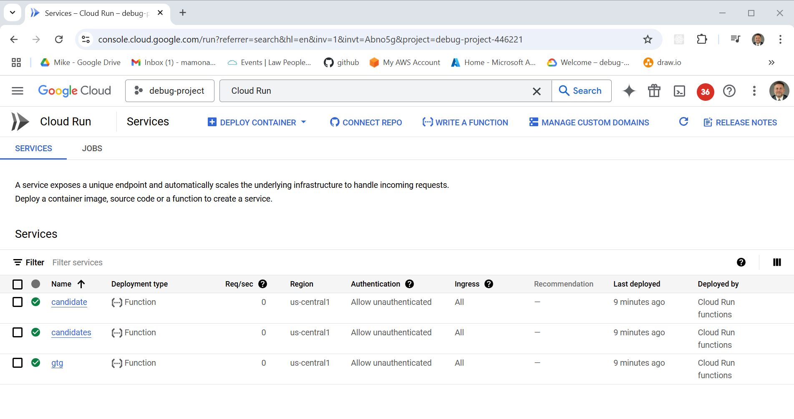
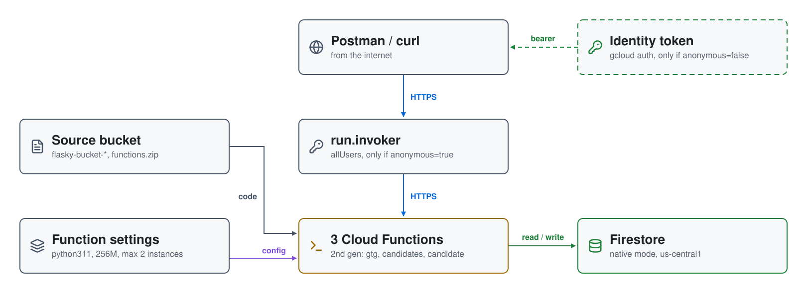
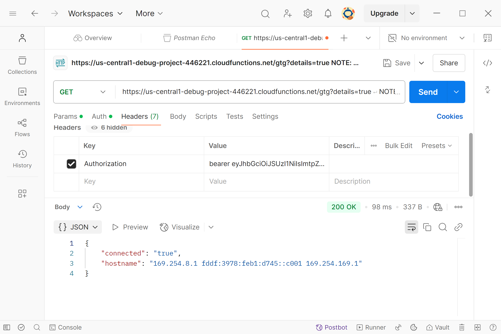

# Serverless Flask-Style API on GCP Cloud Functions

The candidate microservice from the
[GCP Managed Instance Groups](https://youtu.be/AAOZOhREc5o) project, rebuilt
without servers: three second-generation **Cloud Functions** serve the
endpoints, built from source in a **Cloud Storage** bucket, and store
candidates in **Firestore**. One variable switches the functions between
public and authenticated.



| Piece | Where | Role |
|---|---|---|
| **Cloud Functions** | `us-central1`, 2nd gen | `gtg`, `candidates` and `candidate`, Python 3.11, 256 MB, up to 2 instances each; ingress `ALLOW_ALL` |
| **Source bucket** | `us-central1` | `flasky-bucket-<hex>`; holds `functions.zip`, named by its SHA-256 so a code change rebuilds the functions |
| **run.invoker binding** | each function | `allUsers`, only when `anonymous = true` |
| **Firestore** | `us-central1` | native mode database, created by `api_setup.sh` |

## Architecture

<picture>
  <source media="(prefers-color-scheme: dark)" srcset="architecture-dark.svg">
  
</picture>

Regenerate with `python3 make_diagram.py`.

**`01-cloudfunctions/`** is the whole stack: `main.tf` (bucket, source
upload, the three functions, the invoker bindings, and `roles/datastore.user`
for the Terraform service account), `variables.tf` (the function map and
`anonymous`), the code in `code/`, and the `test_candidates` smoke tests.

## API

Each function has its own URL, `https://us-central1-<project>.cloudfunctions.net/<function>`.

| Method | Path | Function | Returns |
|---|---|---|---|
| GET | `/gtg` | `gtg` | 200; with `?details=true`, connection details |
| GET | `/candidate/<name>` | `candidate` | the candidate, or 404 |
| POST | `/candidate/<name>` | `candidate` | `{"CandidateName": <name>}`, or 500 |
| GET | `/candidates` | `candidates` | every candidate, or 404 |

## Prerequisites

* [A Google Cloud Account](https://console.cloud.google.com/)
* [Install gcloud CLI](https://cloud.google.com/sdk/docs/install)
* [Install Terraform](https://developer.hashicorp.com/terraform/install)
* `zip`
* [Postman](https://www.postman.com/downloads/) for testing

Put a service account key in the repository root as `credentials.json`. If
this is your first time watching our content, we recommend starting with
this video: [GCP + Terraform: Easy Setup](https://youtu.be/3spJpYX4f7I).

## Deploy

```bash
git clone https://github.com/mamonaco1973/gcp-flasky-cloud-functions.git
cd gcp-flasky-cloud-functions
./api_setup.sh   # first time: enables the APIs and creates the Firestore database
./apply.sh       # or .\apply.ps1: zips the code, then applies 01-cloudfunctions
```

`apply.sh` ends by running `validate.sh`, which prints an identity token
(only needed when anonymous access is off) and runs the smoke test:

```
NOTE: Bearer token if not deployed anonymous
bearer <token>
NOTE: Health check endpoint is https://us-central1-my-project.cloudfunctions.net/gtg?details=true
✓ good to go passed
✓ insert passed
✓ verification passed
✓ candidate list passed
```

## Try it

1. Call the endpoints with Postman or `curl`, for example
   `curl https://us-central1-<project>.cloudfunctions.net/candidates`.

2. Require authentication. In `01-cloudfunctions/variables.tf`, set
   `anonymous` to `false` (the default is `true`) and run `./apply.sh`
   again; this removes the `allUsers` invoker bindings. After a few minutes,
   `validate.sh` fails every check with `Forbidden`. Add the token it prints
   as an `Authorization: Bearer <token>` header in Postman and the requests
   succeed again.

   

## Teardown

```bash
./destroy.sh     # or .\destroy.ps1
```

## Notes

- **Lab only.** With the default `anonymous = true`, anyone can call the
  functions.
- The functions don't set a service account, so they run as the project's
  default compute service account; the `roles/datastore.user` binding is on
  the Terraform service account.
- The root `main.tf` (a `setup-vm` with SSH and HTTP firewall rules) and
  `apache.png` are leftovers from the gcp-setup project; `apply.sh` doesn't
  use them.
